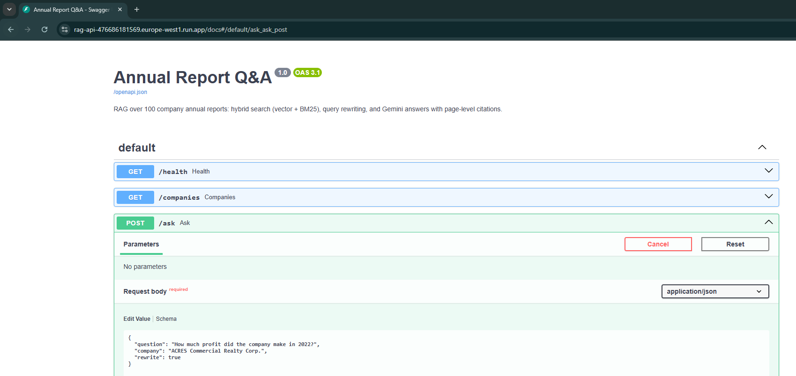
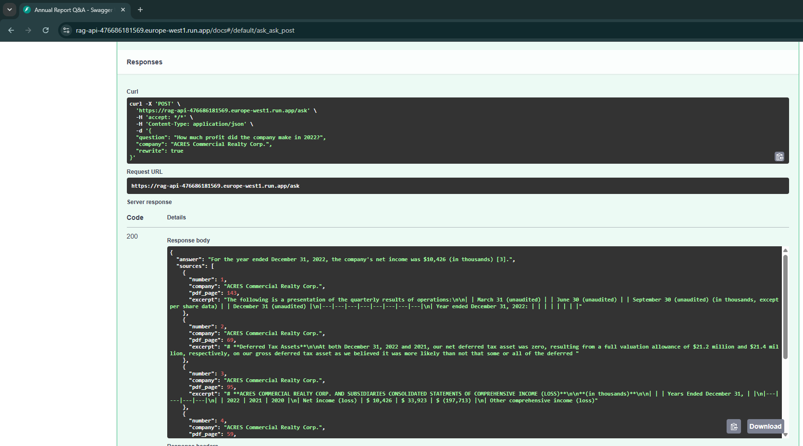
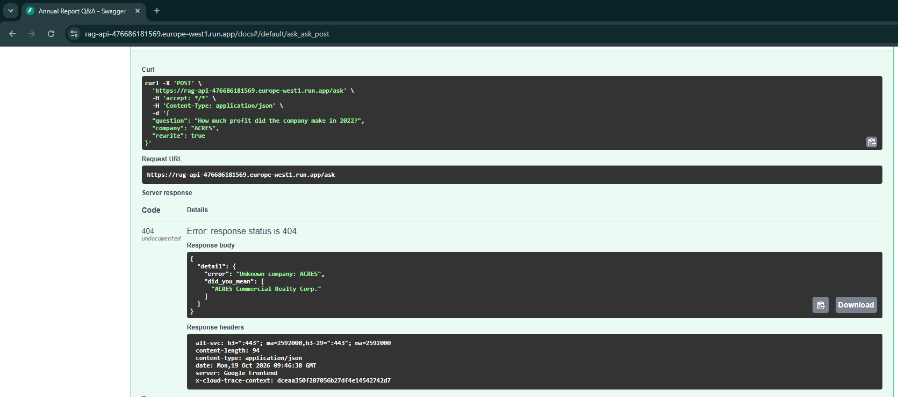
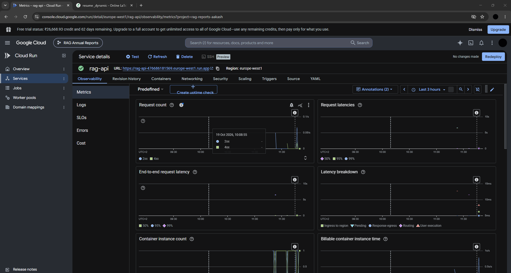
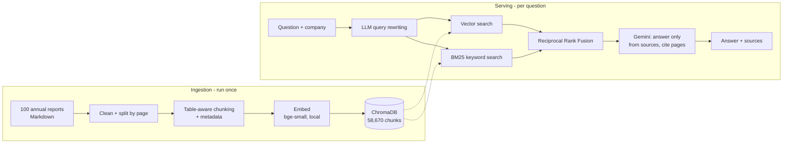

# FinSight RAG

**Question answering over 100 corporate annual reports, with page-level citations.**

Ask a question like *"How much profit did ACRES Commercial Realty make in 2022?"* and get a grounded answer with the exact PDF pages it came from, or an honest "the sources do not contain this information" when the answer isn't there.

The service was deployed on Google Cloud Run (europe-west1) and torn down afterwards to avoid costs. Screenshots of the live deployment are below; the [deploy commands](#run-it) recreate it in about 15 minutes.

### Screenshots

| | |
|---|---|
|  |  |
| Interactive API docs on Cloud Run | Grounded answer citing the income statement (PDF page 95) |
|  |  |
| Helpful 404 with `did_you_mean` suggestions | Cloud Run service in the GCP console |

**Tech:** Python, Gemini API, sentence-transformers (`bge-small-en-v1.5`), ChromaDB, BM25, FastAPI, Pydantic, Docker, Google Cloud Run

---

## How it works



1. **Ingestion.** Reports are cleaned (image links, HTML tags, escaped characters, table padding), split by page so every chunk knows its PDF page, then chunked into ~1,200-character pieces. Tables are never cut in half; large tables are split by rows with the header repeated. Each chunk gets a `Company | Page` header and metadata (company, industry, page).
2. **Embedding.** Chunks are embedded locally with `BAAI/bge-small-en-v1.5` (512-token input limit, so long chunks are not silently truncated as with 256-token models) and stored in ChromaDB.
3. **Retrieval.** Every search is filtered to the requested company. The question is rewritten by an LLM into 2 to 3 queries in annual-report vocabulary ("profit" becomes "net income"). Each query runs both vector search and BM25 keyword search, and all ranked lists are merged with Reciprocal Rank Fusion.
4. **Generation.** Gemini answers using only the top 5 chunks, cites every fact as `[1]`, `[2]`, keeps units such as "in thousands", and refuses when the sources don't contain the answer.

---

## Design decisions and what drove them

Each improvement was made because a measurement showed a specific failure.

| Problem observed | Cause | Fix |
|---|---|---|
| "What was the net income?" returned taxable income, cash, interest income, but never the income statement | Financial tables (mostly numbers and `\|` characters) produce weak embeddings, so they rank far below prose | **Hybrid search**: added BM25 keyword search |
| BM25 alone still ranked the wrong chunks | It scored "net" and "income" separately, and numbers made tables look "long", which BM25 penalises | **Custom tokenizer**: drop numbers and stopwords, add bigrams (`net_income`) |
| Numbers attributed to the wrong company | Search without filtering mixes reports | **Metadata filtering** by company before search |
| "How much profit…?" failed, though the answer was in the report | Users say "profit", reports say "net income": both keyword and vector search miss | **LLM query rewriting** with multi-query RRF fusion |
| Answers marked wrong although correct | Exact key-fact matching is too strict ("stockholder approval is not required" vs "without stockholder approval") | **LLM-as-judge** for non-exact matches, plus page-level retrieval metric |

---

## Evaluation

Two test sets, scored separately for retrieval and answers:

| Test set | Questions | Result |
|---|---|---|
| Synthetic (LLM-generated from random chunks, 5 reports, quality-gated) | 20 | Retrieval: 100% at page level (95% exact chunk). Answers: 100% (2 decided by LLM judge) |
| Hand-written hard set (paraphrases, a sign-flip trap, unanswerable questions) | 8 | 75% with hybrid search, **100% after query rewriting** |

Honest caveats:
- These are small sets. Synthetic questions are easier than real user questions, so treat the scores as upper bounds.
- Results vary somewhat between runs (model updates, non-deterministic rewriting); one paraphrased table question passed in one run and failed in another.
- Every answer marked by the LLM judge was spot-checked by hand.

Run it yourself:

```bash
python evaluate.py                  # synthetic set
python evaluate.py hard_eval.json   # hard set
```

---

## Known limitations

- **Broad questions** ("What are the main risks?") get narrow answers: 5 chunks cannot summarise a whole risk section, and near-duplicate chunks sometimes waste context. Next: deduplication and adaptive `k`.
- **~2% of chunks** exceed the embedding model's 512-token limit and are truncated.
- **Index baked into the container image** (~920 MB compressed). Fine for a demo; in production, ingestion and serving would be separated, with a managed vector database (e.g. PostgreSQL + pgvector) so new reports can be added without redeploying.
- **Dataset labels are imperfect** (e.g. a gold explorer labelled "Pharmaceuticals"); answers come from report text, not labels.
- The demo endpoint has no authentication; cost was capped with `--max-instances 2`. Production would add API keys or IAM and Secret Manager for the Gemini key.

---

## Project structure

| File | Purpose |
|---|---|
| `explore.py` | Inspect the dataset |
| `ingest.py` | Load, clean and chunk reports |
| `embed_store.py` | Embed chunks and store them in ChromaDB |
| `search.py` | Vector search with company filtering |
| `hybrid_search.py` | BM25 + vector search fused with RRF |
| `query_rewrite.py` | LLM query rewriting and multi-query fusion |
| `llm.py` | Gemini calls with retry (429) and model fallback (503) |
| `rag.py` | Full pipeline: retrieve, build prompt, generate |
| `api.py` | FastAPI service: `/ask`, `/companies`, `/health` |
| `make_eval.py` | Generate the synthetic evaluation set |
| `evaluate.py` | Score retrieval and answers (key fact + LLM judge) |
| `eval_set.json`, `hard_eval.json` | Evaluation sets |

---

## Run it

**Data:** [Enterprise RAG Challenge dataset (Kaggle)](https://www.kaggle.com/datasets/rrr3try/enterprise-rag-markdown). Download and unzip into `data/`. It is not included in this repo.

**Locally:**

```bash
pip install -r requirements.txt
echo GEMINI_API_KEY=your_key > .env
python embed_store.py          # one-off, about 1.5 hours on CPU for all 100 reports
uvicorn api:app                # then open http://127.0.0.1:8000/docs
```

**Docker:**

```bash
docker build -t rag-api .
docker run -p 8080:8080 --env-file .env rag-api
```

**Google Cloud Run:**

```bash
docker tag rag-api europe-west1-docker.pkg.dev/PROJECT_ID/rag-repo/rag-api:v1
docker push europe-west1-docker.pkg.dev/PROJECT_ID/rag-repo/rag-api:v1
gcloud run deploy rag-api \
  --image europe-west1-docker.pkg.dev/PROJECT_ID/rag-repo/rag-api:v1 \
  --region europe-west1 --memory 2Gi --cpu 2 --timeout 120 \
  --min-instances 0 --max-instances 2 --allow-unauthenticated \
  --set-env-vars GEMINI_API_KEY=your_key
```

**Tear down** (to stop all costs):

```bash
gcloud run services delete rag-api --region europe-west1
gcloud artifacts repositories delete rag-repo --location europe-west1
```

---

## Roadmap

- [x] v1: RAG pipeline, hybrid search, query rewriting, evaluation, Cloud Run deployment
- [ ] v2: Langfuse tracing, evaluation in CI (GitHub Actions)
- [ ] v3: LangGraph agent combining document search with SQL over extracted financial figures (PostgreSQL + pgvector)
- [ ] v4: Second deployment on Azure Container Apps
