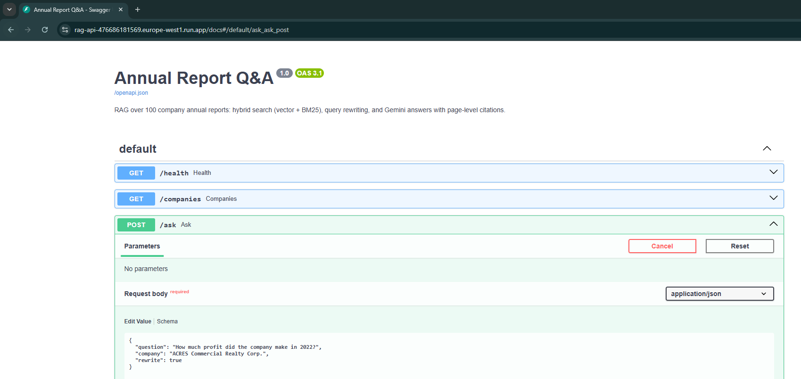
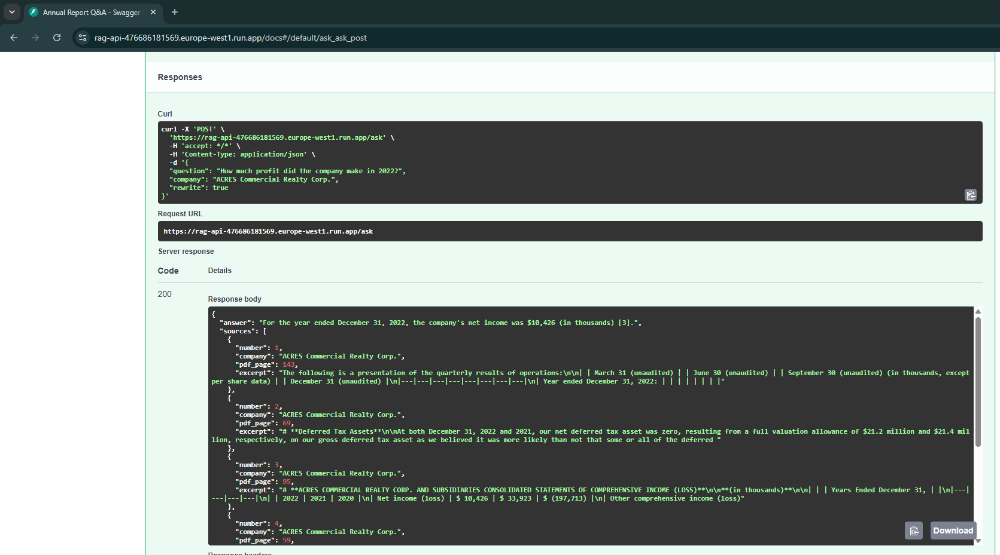
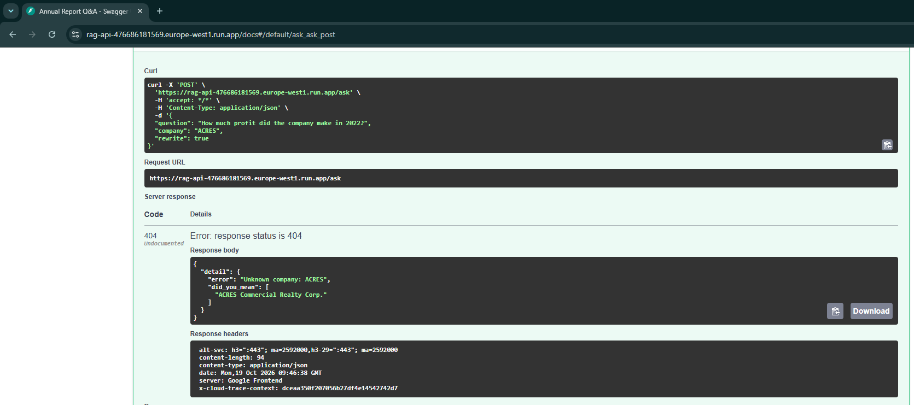
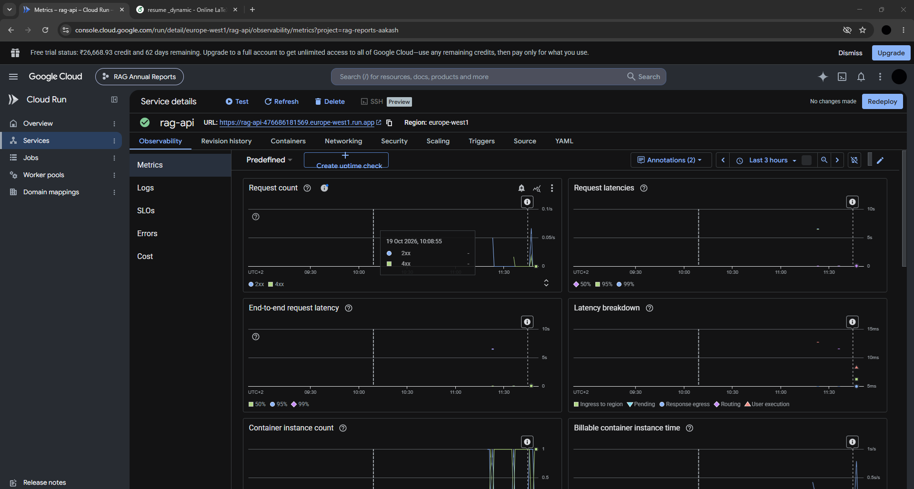
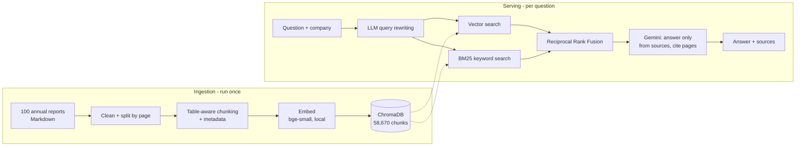
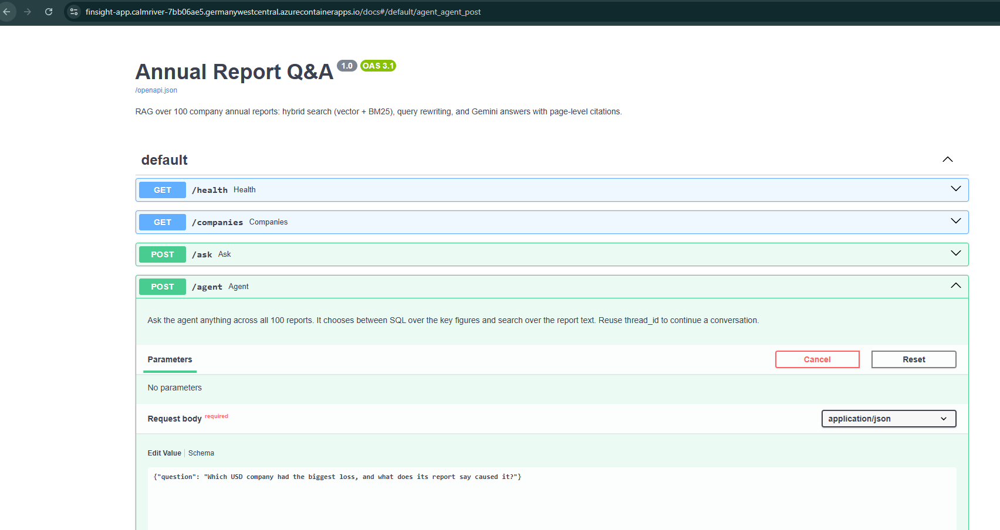
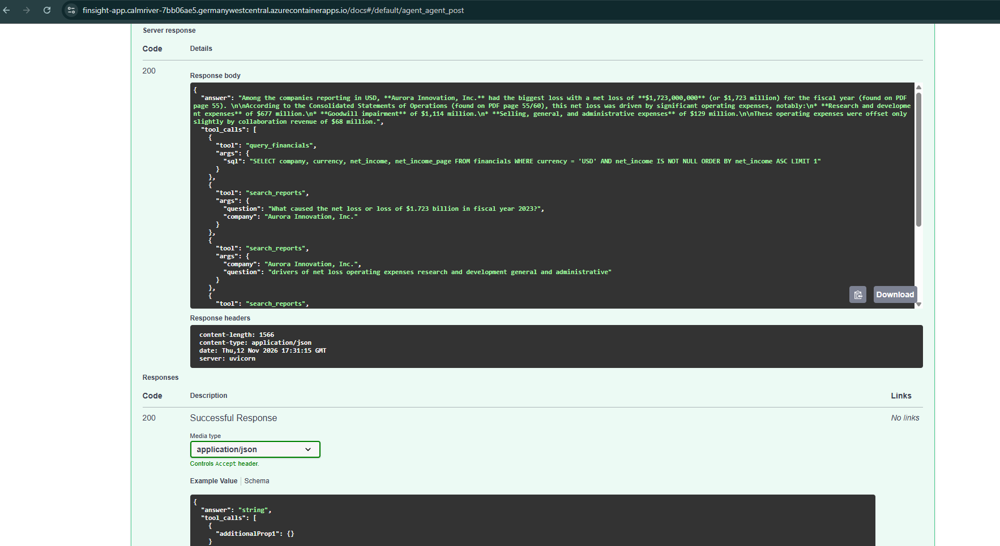
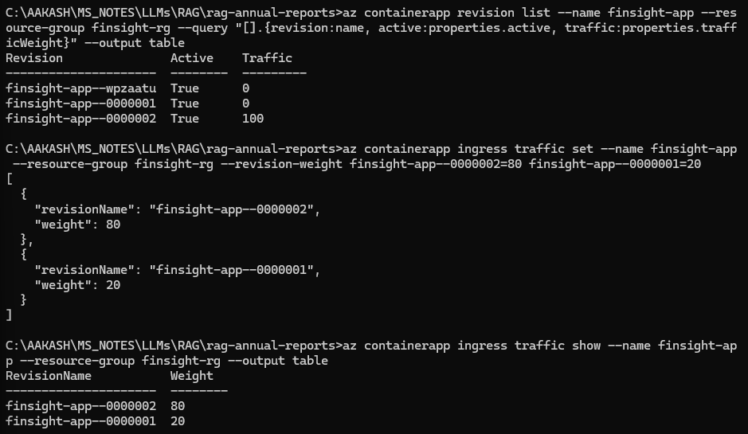
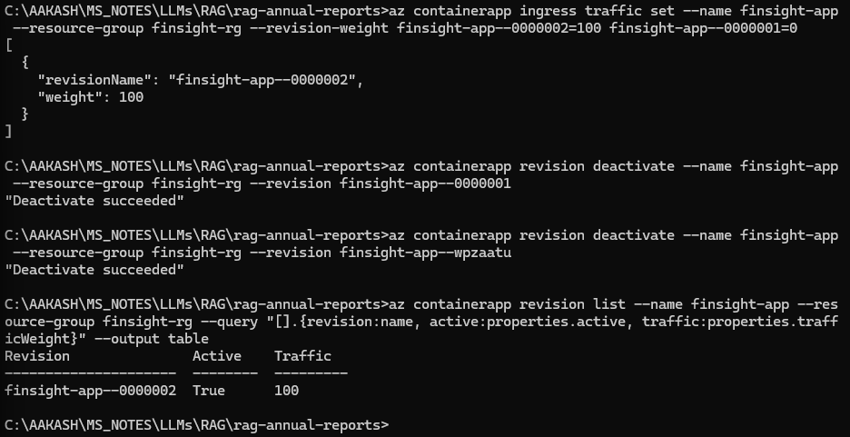

# FinSight RAG
[](https://github.com/AakashDeshpande97/finsight-rag/actions/workflows/ci.yml)


**Question answering over 100 corporate annual reports, with page-level citations.**

Ask a question like *"How much profit did ACRES Commercial Realty make in 2022?"* and get a grounded answer with the exact PDF pages it came from, or an honest "the sources do not contain this information" when the answer isn't there.

On top of the RAG pipeline, a **LangGraph agent** answers questions across all 100 reports (*"Which USD company had the biggest loss, and what caused it?"*) by combining SQL over extracted financial figures with document search.

The system was deployed on **Google Cloud Run** (v1) and **Azure Container Apps** (agent, v3.0.1), then torn down to avoid costs. Screenshots of both deployments are included; the [deploy commands](#run-it) recreate them.

### Screenshots (Cloud Run, v1)

| | |
|---|---|
|  |  |
| Interactive API docs on Cloud Run | Grounded answer citing the income statement (PDF page 95) |
|  |  |
| Helpful 404 with `did_you_mean` suggestions | Cloud Run service in the GCP console |

**Tech:** Python, Gemini API, sentence-transformers (`bge-small-en-v1.5`), ChromaDB, BM25, LangGraph, LangChain, SQLite, Langfuse, FastAPI, Pydantic, pytest, GitHub Actions, Docker, Google Cloud Run, Azure Container Apps

---

## How it works



1. **Ingestion.** Reports are cleaned (image links, HTML tags, escaped characters, table padding), split by page so every chunk knows its PDF page, then chunked into ~1,200-character pieces. Tables are never cut in half; large tables are split by rows with the header repeated. Each chunk gets a `Company | Page` header and metadata (company, industry, page).
2. **Embedding.** Chunks are embedded locally with `BAAI/bge-small-en-v1.5` (512-token input limit, so long chunks are not silently truncated as with 256-token models) and stored in ChromaDB.
3. **Retrieval.** Every search is filtered to the requested company. The question is rewritten by an LLM into 2 to 3 queries in annual-report vocabulary ("profit" becomes "net income"). Each query runs both vector search and BM25 keyword search, and all ranked lists are merged with Reciprocal Rank Fusion.
4. **Generation.** Gemini answers using only the top 8 chunks, cites every fact as `[1]`, `[2]`, keeps units such as "in thousands", and refuses when the sources don't contain the answer.

---

## Design decisions and what drove them

Each improvement was made because a measurement showed a specific failure.

| Problem observed | Cause | Fix |
|---|---|---|
| "What was the net income?" returned taxable income, cash, interest income, but never the income statement | Financial tables (mostly numbers and `\|` characters) produce weak embeddings, so they rank far below prose | **Hybrid search**: added BM25 keyword search |
| BM25 alone still ranked the wrong chunks | It scored "net" and "income" separately, and numbers made tables look "long", which BM25 penalises | **Custom tokenizer**: drop numbers and stopwords, add bigrams (`net_income`) |
| Numbers attributed to the wrong company | Search without filtering mixes reports | **Metadata filtering** by company before search |
| "How much profit…?" failed, though the answer was in the report | Users say "profit", reports say "net income": both keyword and vector search miss | **LLM query rewriting** with multi-query RRF fusion |
| Answers marked wrong although correct | Exact key-fact matching is too strict ("stockholder approval is not required" vs "without stockholder approval") | **LLM-as-judge** for non-exact matches, plus page-level retrieval metric |
| Hard questions failed at random, a different one each run | Langfuse traces showed the right chunk ranked just outside the top 5; prompt tweaks only moved the failures around | **More context**: 8 chunks instead of 5 |
| The agent worked locally but failed on Azure | Unpinned `requirements.txt` installed a newer SDK that used a different API version | **Pinned API and SDK versions** |

---

## Evaluation

Two test sets, scored separately for retrieval and answers:

| Test set | Questions | Result |
|---|---|---|
| Synthetic (LLM-generated from random chunks, 5 reports, quality-gated) | 20 | Retrieval: 100% at page level (95% exact chunk). Answers: 100% (2 decided by LLM judge) |
| Hand-written hard set (paraphrases, a sign-flip trap, unanswerable questions) | 8 | 75% with hybrid search, **100% with query rewriting and 8 chunks of context** |

Honest caveats:
- These are small sets. Synthetic questions are easier than real user questions, so treat the scores as upper bounds.
- Results vary between runs (model updates, non-deterministic rewriting). With 5 chunks of context, failures moved between questions from run to run; raising the context to 8 chunks made the hard set pass consistently.
- Every answer marked by the LLM judge was spot-checked by hand.

Run it yourself:

```bash
python evaluate.py                  # synthetic set
python evaluate.py hard_eval.json   # hard set
```

---

## Observability and CI

- **Langfuse tracing:** every question is traced step by step (query rewriting, each hybrid search, each Gemini call) with latency and token usage. A typical question takes about 2 seconds, of which the two LLM calls take about 70%.
- **Evaluation scores in Langfuse:** each evaluation run attaches `answer_correct`, `page_hit` and `chunk_hit` scores to the question's trace, so a failure can be diagnosed directly from the trace. Example: a failing question about common share *distributions* showed that query rewriting had replaced the report's term with *dividends* in every query.
- **CI (GitHub Actions):** unit tests for cleaning, table-aware chunking, the BM25 tokenizer and company-name suggestions run on every push to `main` and every pull request. The LLM evaluations need API keys and the vector index, so they run manually.

---

## v3: Agent over structured and unstructured data

A LangGraph agent decides per question which tool to use:

| Tool | Data | Used for |
|---|---|---|
| `query_financials` | SQLite table of key figures (revenue, net income, total assets, employees, with source pages) extracted from all 100 reports | Rankings, comparisons, counts across companies |
| `search_reports` | The RAG pipeline above | Explanations, risks, policies, details |

- **Extraction:** one structured-output call per report (Pydantic schema), unit conversion done in code, resumable with checkpointing. Coverage: net income for 91/100 reports, revenue and total assets for 66/100; spot-checked by hand for 3 companies.
- **Safety:** the SQL tool uses a read-only connection and accepts only SELECT queries; the agent loop is capped.
- **Memory:** multi-turn conversations via a LangGraph checkpointer and `thread_id` (`chat.py`, `POST /agent`).
- **Evaluation:** 7 questions covering SQL, document, combined and unanswerable cases, scored for tool choice and answer correctness (7/7 on both), with scores in Langfuse.

Example: *"Which USD company had the biggest loss, and what caused it?"* → SQL finds Aurora Innovation (net loss $1.72B); when the first document search fails, the agent reformulates and finds the $1,114M goodwill impairment.

---

## v4: Deployment on Azure Container Apps

The same container (now including the agent and the financials database) was deployed to **Azure Container Apps** in Germany West Central:

- **Azure Container Registry** for the image, pulled by the app with a **managed identity** (no registry password).
- **Secrets** for the Gemini and Langfuse keys, referenced by environment variables instead of stored in plain text.
- **Scale to zero** with at most 2 replicas, to cap cost.

**A production-only bug, and a controlled rollout.** v3.0.0 worked locally but failed on Azure: `requirements.txt` was unpinned, so the image installed a newer Google SDK that defaulted to the `v1` API, where the `-latest` model aliases don't exist. The local test had only exercised the SQL tool, not the code path that calls Gemini directly. v3.0.1 pins the API version (`v1beta`) and the SDK versions. It was deployed as a new revision, then used to demonstrate:

1. **Canary rollout:** 80% of traffic to v3.0.1, 20% to v3.0.0
2. **Instant rollback:** 100% back to v3.0.1, without rebuilding
3. **Deactivation** of the faulty revision

| | |
|---|---|
|  |  |
| `/agent` endpoint on Azure | Answer combining SQL and document search |
|  |  |
| Canary split 80/20, then rollback | Final state: one active revision |

The Azure resources were deleted afterwards (one resource group, removed with a single command).

---

## Known limitations

- **Broad questions** ("What are the main risks?") get narrow answers: 8 chunks cannot summarise a whole risk section, and near-duplicate chunks sometimes waste context. Next: deduplication and adaptive `k`.
- **Financial figure extraction is incomplete**: net income for 91/100 reports, revenue and total assets for 66/100; currency codes are not validated (one report returned `RMB` instead of `CNY`).
- **~2% of chunks** exceed the embedding model's 512-token limit and are truncated.
- **Index baked into the container image** (~920 MB compressed). Fine for a demo; in production, ingestion and serving would be separated, with a managed vector database (e.g. PostgreSQL + pgvector) so new reports can be added without redeploying.
- **Dataset labels are imperfect** (e.g. a gold explorer labelled "Pharmaceuticals"); answers come from report text, not labels.
- **The demo endpoints had no authentication**; cost was capped with at most 2 instances. The Cloud Run demo passed the Gemini key as a plain environment variable; the Azure deployment used secrets. Production would add API keys or IAM in front of the API.
- **The agent can carry a wrong assumption across turns**, e.g. guessing a fiscal year it never retrieved.
- **Agent memory is in-process** (`InMemorySaver`), so conversations are lost on restart; production would need a database-backed checkpointer.
- **Amounts in 10 currencies are not converted**, so cross-currency comparisons are refused rather than computed.
- **Deployments were demonstrations and have been torn down**: v1 on Google Cloud Run, the agent (v3.0.1) on Azure Container Apps.

## Project structure

| File | Purpose |
|---|---|
| `explore.py` | Inspect the dataset |
| `ingest.py` | Load, clean and chunk reports |
| `embed_store.py` | Embed chunks and store them in ChromaDB |
| `search.py` | Vector search with company filtering |
| `hybrid_search.py` | BM25 + vector search fused with RRF |
| `query_rewrite.py` | LLM query rewriting and multi-query fusion |
| `text_utils.py` | BM25 tokenizer and company-name suggestions (no heavy imports, unit-tested) |
| `llm.py` | Gemini calls with retry (429) and model fallback (503), pinned API version |
| `tracing.py` | Langfuse setup |
| `rag.py` | Full pipeline: retrieve, build prompt, generate |
| `extract_financials.py` | Extract key figures from every report into SQLite (resumable) |
| `check_financials.py` | Data-quality report for the extracted figures |
| `agent.py` | LangGraph agent with SQL and document-search tools, conversation memory |
| `chat.py` | Chat with the agent in the terminal |
| `api.py` | FastAPI service: `/ask`, `/agent`, `/companies`, `/health` |
| `make_eval.py` | Generate the synthetic evaluation set |
| `evaluate.py` | Score retrieval and answers (key fact + LLM judge), scores sent to Langfuse |
| `evaluate_agent.py` | Score the agent's tool choice and answers |
| `eval_set.json`, `hard_eval.json`, `agent_eval.json` | Evaluation sets |
| `tests/` | Unit tests run in CI |

---

## Run it

**Data:** [Enterprise RAG Challenge dataset (Kaggle)](https://www.kaggle.com/datasets/rrr3try/enterprise-rag-markdown). Download and unzip into `data/`. It is not included in this repo.

**Locally:**

```bash
pip install -r requirements.txt
# .env: GEMINI_API_KEY, and optionally LANGFUSE_PUBLIC_KEY, LANGFUSE_SECRET_KEY, LANGFUSE_HOST
python embed_store.py          # one-off, about 1.5 hours on CPU for all 100 reports
python extract_financials.py   # one-off, key figures for the agent (resumable)
uvicorn api:app                # then open http://127.0.0.1:8000/docs
python chat.py                 # or chat with the agent in the terminal
pytest                         # unit tests
```

**Docker:**

```bash
docker build -t rag-api .
docker run -p 8080:8080 --env-file .env rag-api
```

**Google Cloud Run:**

```bash
docker tag rag-api europe-west1-docker.pkg.dev/PROJECT_ID/rag-repo/rag-api:v1
docker push europe-west1-docker.pkg.dev/PROJECT_ID/rag-repo/rag-api:v1
gcloud run deploy rag-api \
  --image europe-west1-docker.pkg.dev/PROJECT_ID/rag-repo/rag-api:v1 \
  --region europe-west1 --memory 2Gi --cpu 2 --timeout 120 \
  --min-instances 0 --max-instances 2 --allow-unauthenticated \
  --set-env-vars GEMINI_API_KEY=your_key
```

**Tear down** (to stop all costs):

```bash
gcloud run services delete rag-api --region europe-west1
gcloud artifacts repositories delete rag-repo --location europe-west1
```

**Azure Container Apps** (registry and app in the same region):

```bash
az group create --name finsight-rg --location germanywestcentral
az acr create --resource-group finsight-rg --name REGISTRY_NAME --sku Basic
az acr login --name REGISTRY_NAME
docker build -t REGISTRY_NAME.azurecr.io/finsight-rag:v3.0.1 .
docker push REGISTRY_NAME.azurecr.io/finsight-rag:v3.0.1
az containerapp env create --name finsight-env --resource-group finsight-rg --location germanywestcentral
az containerapp create --name finsight-app --resource-group finsight-rg --environment finsight-env \
  --image REGISTRY_NAME.azurecr.io/finsight-rag:v3.0.1 \
  --registry-server REGISTRY_NAME.azurecr.io --registry-identity system \
  --target-port 8080 --ingress external --cpu 2 --memory 4Gi \
  --min-replicas 0 --max-replicas 2 --revisions-mode multiple \
  --secrets gemini-key=YOUR_KEY --env-vars GEMINI_API_KEY=secretref:gemini-key
```

Tear down everything with `az group delete --name finsight-rg --yes`.

---

## Roadmap

- [x] v1: RAG pipeline, hybrid search, query rewriting, evaluation, Cloud Run deployment
- [x] v2: Langfuse tracing and evaluation scores, unit tests and CI (GitHub Actions)
- [x] v3: LangGraph agent combining document search with SQL over extracted financial figures
- [x] v4: Deployment on Azure Container Apps with canary rollout and rollback
